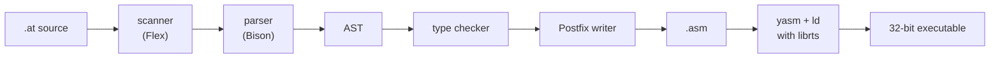

# At

[](https://github.com/alex-quiterio/At-Compiler/actions/workflows/tests.yml)

**At** is a small imperative language with an unusual taste for symbols: `@`
is the return value, `!` prints, `#` allocates, `?` takes an address, and a
function body can be cut into guarded sections. This is its compiler. It
turns `.at` files into 32-bit x86 assembly.

It was written in 2010/11 for the Compilers course at Instituto Superior
Técnico, and ported in 2026 to the course's current toolchain (CDK21 and
RTS7). It passes all 122 programs of the course's reference test suite,
plus 17 more of its own.

```at
// FizzBuzz: consecutive "[c] ? i" form an else-if ladder, ": i" closes it
public int at() -> 0 {
  [int i = 1; i <= 15; i = i + 1] {
    [i % 15 == 0] ? "FizzBuzz"!!
    [i % 3 == 0] ? "Fizz"!!
    [i % 5 == 0] ? "Buzz"!!
    : i!!
  }
}
```

## Quick start

All you need is Docker. The image builds the toolchain from `vendor/`,
builds the compiler, runs every test and builds the examples:

```sh
docker build -t at .
docker run --rm -v "$PWD":/w -w /w at sh -c '
  at examples/fizzbuzz.at &&
  yasm -felf -o fizzbuzz.o examples/fizzbuzz.asm &&
  ld -m elf_i386 -o fizzbuzz fizzbuzz.o -lrts &&
  ./fizzbuzz'
```

RTS7 is 32-bit x86, so the image is `linux/amd64`. It also runs on ARM Macs
under emulation, just more slowly.

## A tour of the language

| You write | It means |
|-----------|----------|
| `public int at() -> 0 { ... }` | the entry point; `-> 0` is the default return value |
| `x!` / `x!!` | print `x` / print it and a newline |
| `@ = x + 1;` | set the return value |
| `@(n - 1)` | call the current function recursively |
| `x = @;` | read a number from the input (a real when `x` is real) |
| `<int> p; p = #n;` | a pointer, pointing at `n` ints reserved on the stack |
| `p[i]`, `x?` | indexing, and the address of `x` |
| `[c] # i` | if |
| `[c] ? i : j` | if-else; `[c1] ? i1 [c2] ? i2 ... : j` chains |
| `[int i = 0; i < n; i = i + 1] i` | for loop; `next` continues, `stop` breaks |
| `@.x`, `@.@` | `x` / the return value of the enclosing function |
| `use int f(int n)` | a function defined in another file (or later in this one) |
| `"a" 'b' 10` | adjacent literals join into one string: `"ab\n"` |
| `6k2`, `3u1` | 6.2E3, 3.1E-6: SI suffixes y z a f p n u m k M G T P E Z Y |

Types are `int`, `real`, `string`, `void` and pointers `<T>`; qualifiers are
`public`, `use` and `const`. Integers can be written in decimal, octal
(`017`), hex (`0x1F`) or binary (`0b101`). `~` is logical not and `^` is
integer power. Operator precedence is C's, from loosest: `=`, `||`, `&&`,
`== !=`, `< > <= >=`, `+ -`, `* / %`, unary `- + ~ #`, then `^`.

### Bodies in sections

A function body can be split into sections, which is what makes At unusual:

```at
public int at() -> 0 << {          // runs first; its variables are visible everywhere
  int n = 7;
}
[n < 0]      { "negative"!! }      // exclusive: when it runs, skip the remaining sections
(n % 2 == 1) { "odd"!! }           // inclusive: run if the condition holds, then go on
{ "always"!! }                     // inclusive, no condition
>> { "done"!! }                    // final: always runs last
```

`return` jumps to the final section, or leaves the function from inside it.

### Functions inside functions

```at
public int at() -> 0 {
  int total = 0;
  int x = 100;
  void add(int x) { total = total + x; @.x = @.x - x; };
  add(1); add(2); add(3);
  "total = "! total! ", x = "! x!!     // total = 6, x = 94
}
```

## Examples

`examples/` holds programs that show the language off. `make examples`
builds each one into `build/examples/`.

| Program | Shows |
|---------|-------|
| [`hello.at`](examples/hello.at) | printing |
| [`fizzbuzz.at`](examples/fizzbuzz.at) | loops and else-if ladders |
| [`factorial.at`](examples/factorial.at) | recursion with `@(...)` and default return values |
| [`primes.at`](examples/primes.at) | a sieve in a stack array (`#n`), `next` |
| [`swap.at`](examples/swap.at) | pointers and addresses |
| [`nested.at`](examples/nested.at) | nested functions and `@.x` |
| [`sections.at`](examples/sections.at) | bodies in sections |
| [`sqrt.at`](examples/sqrt.at) | reals and int-to-real conversion (Newton's method) |
| [`sum.at`](examples/sum.at) | reading input with `@` |

## How it works



The front end is Flex and Bison. The back end is built on **CDK21**, the
course's Compiler Development Kit: it provides the AST base classes, the
compiler driver and the Postfix emitter, which writes x86 assembly. The
program links against **RTS7**, the course runtime, for I/O and start-up.

Some details of the generated code:

- **Calls.** Arguments are pushed last first and start at `ebp+8`; the
  caller removes them. Missing trailing arguments take their default
  literals, converted to the parameter's type.
- **Return values.** `@` is a local slot, initialized from `-> literal` (or
  0). Reals come back in the FPU, everything else in `eax`.
- **Nested functions** are emitted in place, behind a jump. Each one gets a
  hidden first argument, the *static link* (its enclosing function's frame),
  so it can reach enclosing variables at any depth, also when it recurses.
- **`#n`** subtracts `n` elements from the stack pointer. The element type
  comes from the pointer the result is assigned to.
- **`^`** calls a small integer power routine, emitted once per file.
- **Names.** `at` becomes `_main`. A top-level name defined in the file
  that clashes with the RTS (`printi`, `argc`, `_main`, ...) or starts with
  `_` gets an `_at_` prefix.

## Project layout

```
src/
  syntax/
    at_scanner.l, .h      lexer (Flex C++ scanner)
    at_parser.y           grammar and AST construction (Bison)
  ast/                    AST nodes, one header each (namespace at)
  targets/
    basic_ast_visitor.h   base class of the visitors
    symbol.h              symbols, and nested scopes that know function depth
    type_checker.*        types expressions (driven by the code generator)
    frame_size_calculator.*  bytes of locals in a function body
    postfix_writer.*      code generation
    postfix_target.*      registers the "asm" target with CDK
  factory.*               registers the "at" language with CDK
examples/                 sample programs
tests/
  cases/, expected/       test programs and their expected output
  input/                  stdin for the tests that read
  run.sh                  the test runner
vendor/                   CDK21 and RTS7 source archives (GPLv3)
build/                    everything generated (git-ignored), incl. build/at
Dockerfile                toolchain, build, tests and examples
.github/workflows/        CI: the Docker build on every push
```

## Building without Docker

You need CDK21, RTS7, Flex with `libfl-dev`, Bison 3.8, yasm, g++ with
multilib (C++23), Python 3 and GNU make. The archives in `vendor/` build
with `make install`; see the `Dockerfile` for the exact steps.

```sh
make                 # builds build/at
make ROOT=/opt/cdk   # if CDK lives under /opt/cdk/usr instead of /usr
make check           # runs the tests
make examples        # builds the examples into build/examples/
make clean
```

`build/.auto/` holds the node declarations and visitor methods that
`cdk ast` generates from `src/ast/`. A new node only needs a header there
and a `do_..._node` method in each visitor under `src/targets/`.

## Tests

```sh
tests/run.sh                 # all of them
tests/run.sh P-01-100-N-ok   # just one
AT=/path/to/at tests/run.sh  # test another binary
```

Each case is compiled, assembled, linked and run in `tests/out/`, and its
output is compared with `tests/expected/`, ignoring whitespace (the
reference outputs are loose about it: C-01 expects `" 0"`). Cases A to W
are the course's reference suite. The Y cases were added with the port and
cover what that suite doesn't: static links, power, conditional chains,
reals, short-circuit logic, precedence, sections, input, pointers, renamed
RTS names and default arguments.

## History

The original 2010 compiler targeted CDK7 with BYACC; it's in the history
before the port (`0f83f7b`). The port rewrote it on CDK21: a new
conflict-free grammar with C precedence, a new AST, and a new code
generator. It also fixed the old one's bugs, among them a power operator
that looped forever on a zero exponent.
